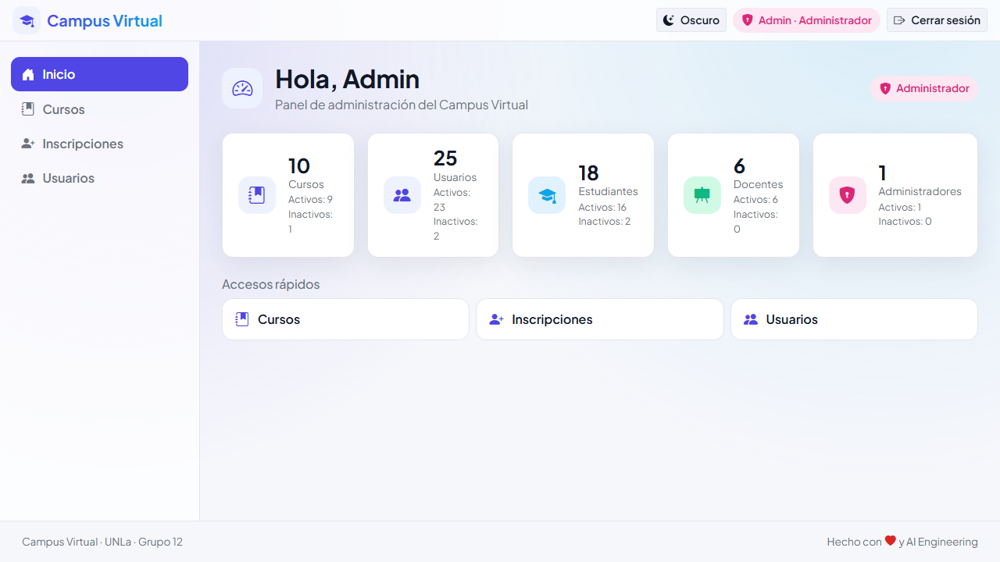
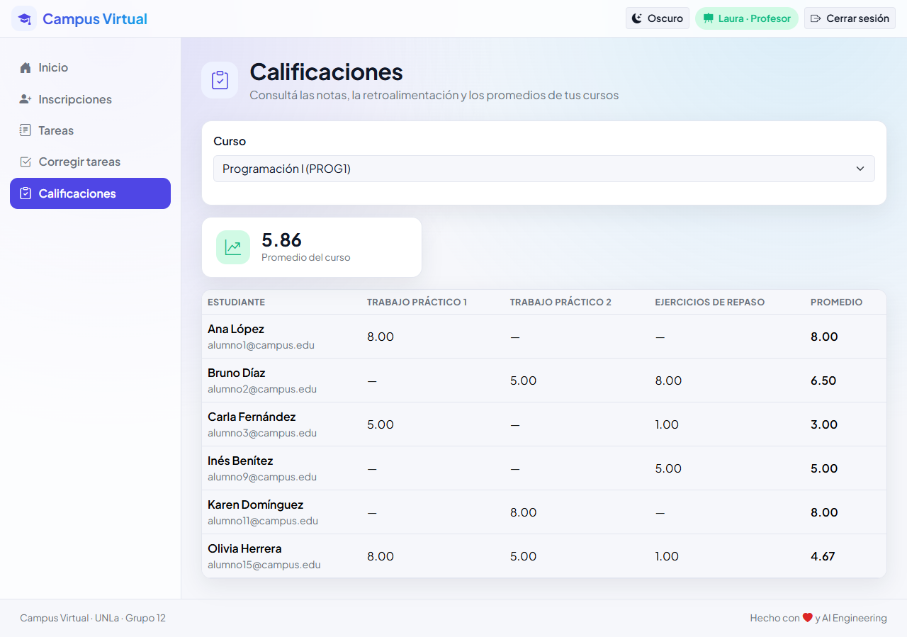
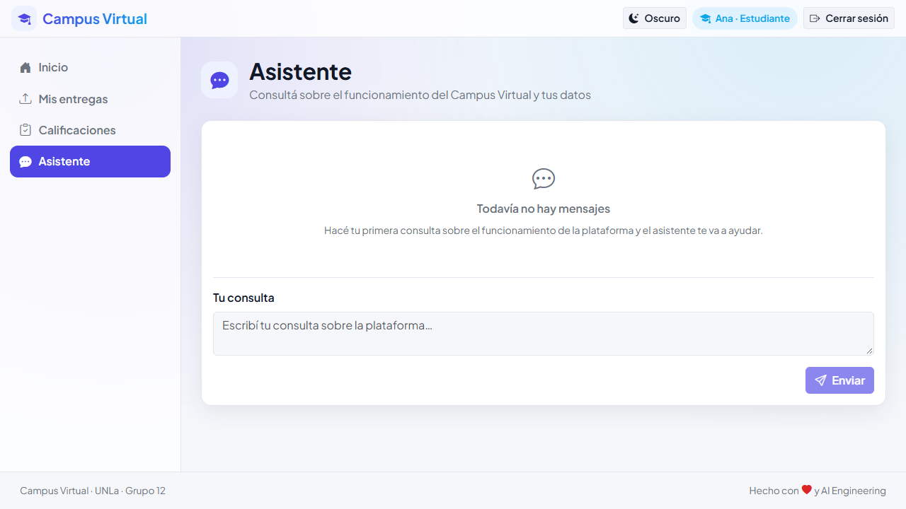

# Campus Virtual

Sistema web de gestión académica (campus virtual) con tres roles —Estudiante, Profesor y Administrador— y un asistente conversacional integrado.

Trabajo Práctico Integrador — Curso IA (UNLa) — Grupo 12.

## Vista previa

| Panel del Administrador | Calificaciones (Profesor) | Chatbot |
|---|---|---|
|  |  |  |

Cada caso de uso tiene su recorrido en tema claro y oscuro dentro de `evidencias/`.

## Arquitectura del sistema

### Backend (Flask)
- **Patrón por capas:** `routes (blueprints) → services (lógica de negocio) → models (SQLAlchemy)`. Las validaciones y reglas de negocio viven exclusivamente en `services/`, nunca en `blueprints/` ni en los modelos.
- **Blueprints por dominio:** `auth`, `courses`, `users`, `tasks`, `enrollments`, `grades`, `chat`, `knowledge`.
- **Persistencia:** SQLite con SQLAlchemy. Esquema versionado con **Flask-Migrate/Alembic** (`backend/migrations/`). `db.create_all()` solo se usa en tests (`TESTING=True`).
- **Autenticación:** sesiones con cookie firmada de Flask (`HttpOnly`, `SameSite=Lax`). Decoradores `@login_required` y `@require_roles` en `backend/blueprints/guards.py`.
- **Chatbot:** LangChain + Ollama local (`qwen3:4b`) con herramientas de solo lectura scopeadas por sesión. Historial en `Conversation/Message`. RAG con **ChromaDB** + `nomic-embed-text` para las fuentes de conocimiento del Administrador (CU-12).

### Frontend (React + Vite)
- **Organización por feature:** `src/features/<feature>/` con componentes, API client y páginas propios.
- **Design system propio:** tokens en `src/theme/tokens.css` (claro/oscuro, color por rol), componentes reutilizables en `src/ui/` (`Button`, `Card`, `Badge`, `RoleBadge`, `PageHeader`, `Spinner`, `EmptyState`, `DataTable`, `FormField`, `Modal`, `ConfirmDialog`, `Toast`), shell en `src/app/` (`AppLayout`, `Navbar`, `Sidebar`, `ProtectedRoute`).
- **Animaciones:** `motion`. Validaciones del lado del servidor son la fuente de verdad; el cliente solo envía y muestra errores.
- **Ruteo:** `react-router-dom` con guards por sesión y rol.

### Casos de uso implementados
Los **12 casos de uso** propuestos fueron implementados, verificados y archivados vía pipeline **spec-driven (OpenSpec)**: CU-01 a CU-12, incluyendo el chatbot (CU-11) con borrado de historial propio y las fuentes de conocimiento (CU-12). Todos cuentan con revisión, evidencias visuales y smoke tests reproducibles.

## Características

- Registro y autenticación de usuarios (**CU-01 y CU-02 implementados**): alta de cuenta, login con cookie de sesión firmada, sesión actual, cierre de sesión.
- Interfaz con **design system propio**: temas claro/oscuro, color por rol (Estudiante/Profesor/Administrador), componentes reutilizables (`src/ui/`) y animaciones con `motion`.
- Gestión de cursos (**CU-03 implementado**): listado (incluye inactivos), alta, edición y activar/desactivar con baja lógica, restringido al Administrador.
- Gestión de usuarios (**CU-04 implementado**): listado (incluye inactivos), edición de datos y rol, activar/desactivar (baja lógica) y reset de contraseña; asignación de Profesor por curso. Restringido al Administrador.
- Gestión de inscripciones (**CU-05 implementado**): pantalla `/enrollments` para elegir un curso gestionable, ver los estudiantes con su estado de inscripción, inscribir, activar/desactivar y eliminar inscripciones. Disponible para Administrador y Profesor.
- Gestión de tareas (**CU-06 implementado**): pantalla `/tasks` para elegir un curso gestionable, listar las tareas (activas e inactivas), crear, editar (incl. la fecha límite) y activar/desactivar. Disponible para el Profesor.
- Entrega de tareas (**CU-07 implementado**): pantalla `/submissions` para elegir un curso, ver las tareas disponibles con su estado de entrega, entregar (texto y/o links), editar y eliminar con confirmación. Disponible para el Estudiante.
- Corrección de tareas (**CU-08 implementado**): pantalla `/grading` para elegir un curso y una tarea, corregir las entregas con una calificación de 1 a 10 y retroalimentación opcional (máx. 5000 caracteres), ver el estado derivado aprobado/desaprobado y modificar una corrección existente. Disponible para el Profesor.
- Consulta de calificaciones (**CU-09 implementado**): pantalla `/grades` para elegir un curso y ver, como Estudiante, el detalle por tarea (nota, retroalimentación, aprobado/desaprobado) con el promedio del curso; como Profesor, la matriz estudiante × tarea con el promedio de cada estudiante y el promedio del curso.
- Filtrado de usuarios (**CU-10 implementado**): barra de filtros del listado de usuarios (q/role/active) con estado vacío A1, accesible solo para el Administrador.
- Chatbot asistente (**CU-11 implementado**): pantalla `/chat` con un agente local LangChain + Ollama (`qwen3:4b`) que responde consultas sobre la plataforma y sobre datos reales del sistema según el rol del usuario; solo lectura (no crea, modifica ni califica). Fallo del modelo local → mensaje amable, sin persistir el turno.
- Fuentes de conocimiento del chatbot (**CU-12 implementado**): pantalla `/knowledge` (solo Administrador) para cargar, listar y eliminar fuentes `.md`/`.txt` (≤ 1 MB) que el chatbot usa como contexto RAG (ChromaDB + embeddings locales); alta/índice/consulta scopeados por rol.

## Tecnologías

| Área | Tecnología |
|------|-----------|
| Backend | Python + Flask |
| Frontend | React + Vite (Node) |
| Base de datos | SQLite |
| ORM | SQLAlchemy |
| Chatbot | LangChain + Ollama (local) |

Las versiones exactas están en `backend/requirements.txt` (backend) y `frontend/package.json` (frontend).

## Requisitos previos

- Python 3.14 (verificado en 3.14.6) y `pip`.
- Node.js v24 (verificado en v24.19.0) y `npm`.
- En Windows, `npm` se invoca como `cmd /c npm ...` por la execution policy de PowerShell.
- **Ollama** para el chatbot (CU-11) y para indexar fuentes de conocimiento (CU-12): el servidor local debe estar ejecutándose y los modelos descargados (ver «Ollama y el chatbot» más abajo).

## Instalación

```bash
# Backend (desde la raíz del proyecto)
python -m venv .venv
# Windows
.\.venv\Scripts\python.exe -m pip install -r backend\requirements.txt
# Linux/macOS
.venv/bin/python -m pip install -r backend/requirements.txt

# Frontend
cd frontend
npm install        # Windows: cmd /c npm install
```

## Ejecución

```bash
# Backend (desde la raíz) → http://127.0.0.1:5000
.\.venv\Scripts\python.exe backend\app.py   # Windows
.venv/bin/python backend/app.py             # Linux/macOS

# Frontend → http://localhost:5173
cd frontend && npm run dev             # Linux/macOS
cmd /c "cd frontend && npm run dev"    # Windows (PowerShell 5.1)
```

El servidor de desarrollo de Vite proxea `/api` hacia `http://localhost:5000`.

### Ollama y el chatbot

El chatbot (CU-11, `/chat`) llama a **Ollama corriendo en local**; el backend es un cliente que se conecta a `http://127.0.0.1:11434`, no lo arranca él mismo. Requisitos una sola vez:

```bash
# Servidor Ollama (la app de escritorio de Windows lo deja corriendo en la bandeja)
ollama serve
# Modelo usado por el chatbot (una vez descargado queda disponible sin conexión)
ollama pull qwen3:4b
# Modelo de embeddings usado para indexar las fuentes de conocimiento (CU-12)
ollama pull nomic-embed-text
```

Si Ollama no está corriendo o el modelo no existe, **el resto de la app funciona normal**; solo el chatbot responde 502 con un mensaje amable («no se pudo completar la consulta») y ese turno no se guarda en el historial.

Variables de entorno opcionales del chatbot (con sus valores por defecto):

| Variable | Default | Purpose |
|----------|---------|---------|
| `OLLAMA_MODEL` | `qwen3:4b` | Modelo usado por el agente |
| `OLLAMA_BASE_URL` | `http://127.0.0.1:11434` | URL del servidor Ollama |
| `OLLAMA_TIMEOUT` | `120` | Timeout por invocación (segundos) |
| `CHAT_HISTORY_WINDOW` | `10` | Ventana de mensajes enviados al modelo por turno |
| `CHAT_MESSAGE_MAX_LENGTH` | `4000` | Longitud máxima del mensaje del usuario |

### Fuentes de conocimiento del chatbot (CU-12)

El Administrador gestiona en `/knowledge` las fuentes `.md`/`.txt` (≤ 1 MB) que el chatbot usa como contexto. La carga indexa el documento de forma síncrona en ChromaDB local con embeddings de Ollama (`nomic-embed-text`, ver el bloque de arriba); sin ese modelo, el alta responde 400 con la fuente en estado `error` (visible en la pantalla) y el resto de la app sigue funcionando.

Variables de entorno de las fuentes de conocimiento (con sus valores por defecto):

| Variable | Default | Purpose |
|----------|---------|---------|
| `OLLAMA_EMBED_MODEL` | `nomic-embed-text` | Modelo de embeddings para indexar |
| `CHROMA_PERSIST_DIR` | `instance/chroma` | Directorio de persistencia de ChromaDB |
| `CHROMA_COLLECTION` | `campus_knowledge` | Nombre de la colección vectorial |
| `KNOWLEDGE_MAX_FILE_BYTES` | `1048576` | Tamaño máximo del archivo cargado (1 MB) |
| `KNOWLEDGE_UPLOAD_DIR` | `instance/knowledge` | Directorio donde se guardan los archivos cargados |

### Migraciones de esquema

El esquema se versiona con migraciones (Flask-Migrate/Alembic, `backend/migrations/`). Sobre una base nueva o desactualizada hay que aplicar las migraciones pendientes:

```bash
# Desde backend/ (Windows)
..\.venv\Scripts\python.exe -m flask --app app db upgrade
# Linux/macOS: ../.venv/bin/python -m flask --app app db upgrade
```

El seed del Administrador (`scripts/seed_admin.py`) aplica las migraciones pendientes de forma automática antes de sembrar.

## Testing

```bash
# Backend (desde backend/)
..\.venv\Scripts\python.exe -m pytest        # Linux/macOS: ../.venv/bin/python -m pytest

# Frontend (desde frontend/)
npm run build                                 # Windows: cmd /c npm run build

# Lint / formato (backend, desde la raíz)
.\.venv\Scripts\python.exe -m ruff check backend
.\.venv\Scripts\python.exe -m ruff format --check backend   # Linux/macOS: .venv/bin/python -m ruff ...

# Lint / formato (frontend, desde frontend/)
npm run lint:format                           # Windows: cmd /c npm run lint:format

# Smoke end-to-end (arranca servicios, valida y limpia; por defecto CU-02)
..\.venv\Scripts\python.exe scripts\verify.py                 # Linux/macOS: .venv/bin/python ...
..\.venv\Scripts\python.exe scripts\verify.py --diagnose     # estado de puertos/pids (read-only)
..\.venv\Scripts\python.exe scripts\verify.py --cu cu02      # smoke de autenticación (login/registro/sesión)
..\.venv\Scripts\python.exe scripts\verify.py --cu cu03      # siembra admin + cursos y corre smoke_cu03
..\.venv\Scripts\python.exe scripts\verify.py --cu cu04      # smoke de gestión de usuarios y profesores
..\.venv\Scripts\python.exe scripts\verify.py --cu cu05      # smoke de gestión de inscripciones
..\.venv\Scripts\python.exe scripts\verify.py --cu cu06      # smoke de gestión de tareas
..\.venv\Scripts\python.exe scripts\verify.py --cu cu07      # smoke de entrega de tareas
..\.venv\Scripts\python.exe scripts\verify.py --cu cu08      # smoke de corrección de tareas
..\.venv\Scripts\python.exe scripts\verify.py --cu cu09      # smoke de consulta de calificaciones
..\.venv\Scripts\python.exe scripts\verify.py --cu cu10      # smoke de filtrado de usuarios
..\.venv\Scripts\python.exe scripts\verify.py --cu cu11      # smoke del chatbot
..\.venv\Scripts\python.exe scripts\verify.py --cu cu12      # smoke de fuentes de conocimiento
..\.venv\Scripts\python.exe scripts\verify.py --serve --db backend\instance\campus.db
                                                             # deja backend + Vite vivos y desligados (evidencia UI)
..\.venv\Scripts\python.exe scripts\verify.py --cleanup       # detiene los servicios de --serve/--keep
```

Cada smoke corre contra una base temporal aislada y sembrada, así que no toca la base de desarrollo. El de CU-11 funciona con Ollama apagado (valida el camino de error 502 y marca los pasos dependientes del modelo con `[SKIP]`); el de CU-12 necesita el modelo de embeddings para completar el alta de una fuente.

`--serve` levanta los servicios **desligados** del proceso del agente (en Windows con `DETACHED_PROCESS`) y vuelve enseguida, dejando los pids en `scripts/.verify-pids`; es el modo que se usa para capturar evidencia con Playwright. `--cleanup` los detiene (en Windows mata el árbol de procesos).

## Estructura

```
/
├── AGENTS.md          # instrucciones para agentes de IA
├── README.md          # este archivo
├── opencode.json      # configuración de proyecto (MCP, permisos)
├── casos_de_uso.md    # especificación de los 10 casos de uso
├── decisiones/        # registro de decisiones (README.md + 00-general.md + cu-0X.md)
├── errores/           # bitácora de errores (README.md + 00-general.md + cu-0X.md)
├── progreso.md        # control de progreso
├── docs/              # documentación de soporte (docs/er-diagrama.md: diagrama entidad-relación)
├── openspec/          # specs spec-driven (fuente de verdad de specs)
├── backend/           # API Flask (app.py, config/, models/, services/, blueprints/, migrations/, tests/)
└── frontend/          # SPA React + Vite (src/api/, src/features/, src/theme/, src/ui/, src/app/)
```

## API

| Método | Ruta | CU | Propósito | Auth |
|--------|------|----|-----------|------|
| POST | `/api/auth/register` | CU-01 | Registrar una cuenta (rol Estudiante) | Público |
| POST | `/api/auth/login` | CU-02 | Iniciar sesión (emite cookie de sesión) | Público |
| GET | `/api/auth/me` | CU-02 | Obtener el usuario autenticado | Sesión |
| POST | `/api/auth/logout` | CU-02 | Cerrar sesión (idempotente) | Sesión |
| GET | `/api/courses` | CU-03 | Listar cursos (incluye inactivos) | Sesión + Administrador |
| POST | `/api/courses` | CU-03 | Crear un curso (201/400/409) | Sesión + Administrador |
| GET | `/api/courses/<id>` | CU-03 | Obtener un curso (200/404) | Sesión + Administrador |
| PUT | `/api/courses/<id>` | CU-03 | Editar un curso (200/400/404/409) | Sesión + Administrador |
| PATCH | `/api/courses/<id>` | CU-03 | Activar/desactivar un curso — body `{"active": <bool>}` | Sesión + Administrador |
| GET | `/api/users` | CU-04, CU-10 | Listar usuarios (incluye inactivos); filtros opcionales `q`/`role`/`active` | Sesión + Administrador |
| GET | `/api/users/<id>` | CU-04 | Obtener un usuario (200/404) | Sesión + Administrador |
| PUT | `/api/users/<id>` | CU-04 | Editar datos y rol (200/400/404/409) | Sesión + Administrador |
| PATCH | `/api/users/<id>` | CU-04 | Activar/desactivar — body `{"active": <bool>}` (200/400/404) | Sesión + Administrador |
| POST | `/api/users/<id>/password` | CU-04 | Resetear contraseña — body `{"password": "..."}` (200/400/404) | Sesión + Administrador |
| GET | `/api/courses/<id>/teachers` | CU-04 | Listar profesores del curso (200/404) | Sesión + Administrador |
| POST | `/api/courses/<id>/teachers` | CU-04 | Asignar profesor — body `{"teacher_id": <id>}` (201/400/404/409) | Sesión + Administrador |
| DELETE | `/api/courses/<id>/teachers/<teacher_id>` | CU-04 | Quitar profesor del curso (200/404) | Sesión + Administrador |
| GET | `/api/courses/mine` | CU-05 | Listar los cursos del usuario (Admin: todos; Profesor: asignados; Estudiante: inscritos) | Sesión + Administrador/Profesor/Estudiante |
| GET | `/api/courses/<id>/students` | CU-05 | Listar estudiantes activos con su inscripción (200/403/404) | Sesión + Administrador/Profesor |
| POST | `/api/courses/<id>/students` | CU-05 | Inscribir estudiante — body `{"student_id": <id>}` (201/400/403/404/409) | Sesión + Administrador/Profesor |
| PATCH | `/api/courses/<id>/students/<student_id>` | CU-05 | Activar/desactivar inscripción — body `{"active": <bool>}` (200/400/403/404/409) | Sesión + Administrador/Profesor |
| DELETE | `/api/courses/<id>/students/<student_id>` | CU-05 | Eliminar inscripción (200/403/404) | Sesión + Administrador/Profesor |
| GET | `/api/courses/<id>/tasks` | CU-06/07 | Listar tareas del curso (Profesor: activas e inactivas; Estudiante: disponibles + entrega propia) (200/403/404) | Sesión + Profesor/Estudiante |
| POST | `/api/courses/<id>/tasks` | CU-06 | Crear una tarea (201/400/403/404/409) | Sesión + Profesor |
| GET | `/api/courses/<id>/tasks/<task_id>` | CU-06 | Obtener una tarea (200/403/404) | Sesión + Profesor |
| PUT | `/api/courses/<id>/tasks/<task_id>` | CU-06 | Editar una tarea, incl. fecha límite (200/400/403/404/409) | Sesión + Profesor |
| PATCH | `/api/courses/<id>/tasks/<task_id>` | CU-06 | Activar/desactivar tarea — body `{"active": <bool>}` (200/400/403/404) | Sesión + Profesor |
| POST | `/api/courses/<id>/tasks/<task_id>/submission` | CU-07 | Entregar una tarea — body `{"content", "links"}` (201/400/403/404/409) | Sesión + Estudiante |
| PUT | `/api/courses/<id>/tasks/<task_id>/submission` | CU-07 | Modificar la entrega propia (200/400/403/404/409) | Sesión + Estudiante |
| DELETE | `/api/courses/<id>/tasks/<task_id>/submission` | CU-07 | Eliminar la entrega propia (200/403/404/409) | Sesión + Estudiante |
| GET | `/api/courses/<id>/tasks/<task_id>/submissions` | CU-08 | Listar las entregas de la tarea con datos del estudiante y estado de corrección (200/403/404) | Sesión + Profesor |
| PUT | `/api/courses/<id>/tasks/<task_id>/submissions/<student_id>/grade` | CU-08 | Corregir o modificar una entrega — body `{"grade": 1..10, "feedback"?: str}` (200/400/403/404) | Sesión + Profesor |
| GET | `/api/courses/<id>/grades` | CU-09 | Consultar calificaciones del curso según el rol (Estudiante: sus notas, retroalimentación y promedio; Profesor: matriz estudiante × tarea y promedio del curso) (200/401/403/404) | Sesión + Profesor/Estudiante |

### Pantallas del frontend (rutas)

| Ruta | Pantalla | Acceso |
|------|----------|--------|
| `/` | Inicio (panel según rol) | Sesión |
| `/login` | Iniciar sesión (CU-02) | Público |
| `/register` | Registrarse (CU-01) | Público |
| `/courses` | Gestión de cursos (CU-03) | Administrador |
| `/users` | Gestión de usuarios (CU-04) | Administrador |
| `/enrollments` | Gestión de inscripciones (CU-05) | Administrador / Profesor |
| `/tasks` | Gestión de tareas (CU-06) | Profesor |
| `/submissions` | Entrega de tareas (CU-07) | Estudiante |
| `/grading` | Corrección de tareas (CU-08) | Profesor |
| `/grades` | Consulta de calificaciones (CU-09) | Estudiante / Profesor |
| `/chat` | Chatbot de asistencia (CU-11) | Estudiante / Profesor / Administrador |
| `/knowledge` | Fuentes de conocimiento del chatbot (CU-12) | Administrador |

## Configuración

Variables de entorno (con valores por defecto para desarrollo):

- `CAMPUS_DB_PATH`: ruta del archivo SQLite (default `backend/instance/campus.db`).
- `SECRET_KEY`: clave de sesión (default solo de desarrollo; fijar en producción).
- `CAMPUS_ADMIN_EMAIL`: correo del Administrador inicial (**obligatoria** para el seed).
- `CAMPUS_ADMIN_PASSWORD`: contraseña del Administrador inicial (**obligatoria** para el seed).

### Bootstrap del Administrador

El primer Administrador (y 4 cursos de demostración) se crean con un seed idempotente. Requiere las dos variables `CAMPUS_ADMIN_*`:

```bash
# Windows
$env:CAMPUS_ADMIN_EMAIL="admin@example.com"; $env:CAMPUS_ADMIN_PASSWORD="una-clave-segura"
.\.venv\Scripts\python.exe scripts\seed_admin.py
# Linux/macOS
CAMPUS_ADMIN_EMAIL=admin@example.com CAMPUS_ADMIN_PASSWORD=una-clave-segura .venv/bin/python scripts/seed_admin.py
```

Si el Administrador ya existe, el script no duplica nada. El registro público (`/api/auth/register`) siempre crea rol Estudiante; un Administrador sólo se crea por este seed.

### Datos de prueba

El seed del Administrador crea el Administrador y cuatro cursos (`PROG1`, `MAT1`, `FIS1` y `HIST1`, este último inactivo), pero **no crea Profesores, Estudiantes, inscripciones, tareas ni entregas**. Para probar los casos de uso de tareas, entregas, corrección y calificaciones hace falta el seed de demostración, que se ejecuta **después** del anterior y desde la raíz del proyecto:

```bash
# Windows
.\.venv\Scripts\python.exe scripts\seed_demo.py
# Linux/macOS
.venv/bin/python scripts/seed_demo.py
```

Es idempotente: busca cada registro por su clave natural (correo, par curso–profesor, par curso–estudiante, par tarea–estudiante) antes de insertarlo, así que se puede correr las veces que haga falta sin duplicar nada. También aplica las migraciones pendientes. Si no encuentra los cursos demo, avisa que hay que correr `seed_admin.py` primero y termina con error.

Qué deja sembrado:

- 6 cursos adicionales (`ALG1`, `BD1`, `REDES1`, `QUIM1`, `PROG2`, `ING1`): 10 cursos en total.
- 6 Profesores y 18 Estudiantes (2 inactivos), con 14 asignaciones Profesor–curso e inscripciones activas e inactivas.
- Tareas activas e inactivas, con plazos futuros y vencidos.
- Entregas de tareas y la corrección de una porción determinista de ellas.

Credenciales de demostración por defecto (las contraseñas se pueden cambiar definiendo las variables **antes** de correr el script):

| Rol | Correo | Contraseña | Variable de entorno |
|-----|--------|-----------|---------------------|
| Administrador | el definido en `CAMPUS_ADMIN_EMAIL` | el definido en `CAMPUS_ADMIN_PASSWORD` | `CAMPUS_ADMIN_*` |
| Profesor | `docente1@campus.edu` … `docente6@campus.edu` | `Docente123` | `CAMPUS_DEMO_TEACHER_PASSWORD` |
| Estudiante | `alumno1@campus.edu` … `alumno18@campus.edu` | `Alumno123` | `CAMPUS_DEMO_STUDENT_PASSWORD` |

> Las credenciales de demostración son públicas y sirven sólo para desarrollo local. No las uses en un entorno real.

El diagrama entidad-relación de la base (tablas, columnas, restricciones e invariantes de negocio) está en [`docs/er-diagrama.md`](docs/er-diagrama.md).

#### Reiniciar la base local

Para volver a un estado limpio: detené el backend, borrá `backend/instance/campus.db` y corré los dos seeds en orden (aplican las migraciones solos). `backend/instance/` está en `.gitignore`, así que la base no viene en el repositorio.

```bash
# Windows, desde la raíz del proyecto
Remove-Item backend\instance\campus.db
$env:CAMPUS_ADMIN_EMAIL="admin@example.com"; $env:CAMPUS_ADMIN_PASSWORD="una-clave-segura"
.\.venv\Scripts\python.exe scripts\seed_admin.py
.\.venv\Scripts\python.exe scripts\seed_demo.py

# Linux/macOS: rm backend/instance/campus.db y correr los seeds con .venv/bin/python
```

Un reset completo incluye además `backend/instance/chroma` (índice vectorial) y `backend/instance/knowledge` (archivos de fuentes de conocimiento), que se recrean al volver a cargar fuentes.

## Servidores MCP (Model Context Protocol)

El desarrollo se apoya en cinco servidores MCP. La configuración vive en **dos niveles** para cumplir con el requisito de reproducibilidad:

### Configuración por nivel

**`opencode.json` (proyecto, commiteado):**
```json
{
  "mcp": {
    "filesystem": {
      "type": "local",
      "enabled": true,
      "command": ["cmd", "/c", "npx", "-y", "@modelcontextprotocol/server-filesystem", "C:/Users/.../tp 2"]
    },
    "playwright": {
      "type": "local",
      "enabled": true,
      "command": ["cmd", "/c", "npx", "-y", "@playwright/mcp@latest", "--headless", "--browser", "chromium"]
    }
  },
  "permission": { "bash": {...}, "read": {...} }
}
```

**`~/.config/opencode/opencode.jsonc` (config global, fuera del repo):**
```jsonc
{
  "default_agent": "gentle-orchestrator",
  "mcp": {
    "context7": { "type": "remote", "url": "https://mcp.context7.com/mcp" },        // externo
    "engram": { "type": "local", "command": ["engram", "--tools=agent"] },         // memoria persistente
    "github": { "type": "local", "command": ["github-mcp-server", "stdio", "--read-only", "--toolsets=repos,issues,pull_requests,actions"], "environment": {"GITHUB_MCP_TOKEN": "{env:GITHUB_MCP_TOKEN}"} }
  }
}
```

### Roles por servidor

| Servidor | Tipo | Origen | Rol en el desarrollo |
|----------|------|--------|----------------------|
| `engram` | Memoria (local) | Config global | Memoria persistente del proyecto: decisiones, gotchas y estado que sobreviven entre sesiones y a la compactación de contexto. Usado para `mem_save`, `mem_search`, `mem_context`, `mem_session_summary`. |
| `context7` | Documentación (remoto/externo) | Config global | **MCP externo requerido.** Documentación actualizada de Flask, SQLAlchemy, React, Vite, LangChain y Ollama; reduce APIs alucinadas por el modelo. |
| `filesystem` | Filesystem (local) | `opencode.json` (proyecto) | Acceso a archivos acotado por allowlist a la carpeta del proyecto. Valor demostrativo del protocolo; opencode ya dispone de acceso a archivos nativo. |
| `playwright` | Browser e2e (local) | `opencode.json` (proyecto) | Validación real de la UI por CU: navegar, completar formularios y capturar screenshots como evidencia verificable (`@playwright/mcp`, headless + chromium). Complementa a pytest y al smoke HTTP. |
| `github` | Repositorio y CI (remoto vía API) | Config global | Servidor `github-mcp-server` en modo **solo lectura** (`--read-only`, toolsets `repos,issues,pull_requests,actions`) para inspeccionar el repositorio, issues, PRs y runs de Actions. Token por `GITHUB_MCP_TOKEN`. Apoyo de inspección; commits/push se hacen con `git`. |

- **Terminal:** herramienta nativa de opencode (sin MCP de terminal).
- **Comando del MCP filesystem:** `cmd /c npx -y @modelcontextprotocol/server-filesystem "<ruta del proyecto>"` (Windows requiere `cmd /c` por execution policy).
- **Portabilidad:** las rutas del MCP filesystem y el binario de `github-mcp-server` son específicos de esta máquina (config global). Para correr en otra máquina hay que ajustarlos; `opencode.json` del proyecto es portable en estructura. Ninguno de los dos es requisito para que la aplicación funcione.

## Repositorio

- URL: https://github.com/Franco2900/campus-virtual
- Rama por defecto: `main`. Commits por unidad de trabajo (Conventional Commits). `.atl/` (herramientas locales generadas) está en `.gitignore`.

## Ingeniería con IA (AI Engineering)

### Metodología y orquestación
- **Instrucciones del sistema:** `AGENTS.md` actúa como fuente de verdad operativa para el agente (arquitectura, convenciones, verificación, evidencia, heartbeat, fases/sesiones, optimización de tokens, portabilidad). Se inyecta en el contexto del agente en cada sesión.
- **Plantilla maestra:** `Plantilla para proyecto con IA/Prompt maestro para inicializar proyectos.txt` guio la inicialización: inspección obligatoria antes de escribir código, regla "preguntar antes de asumir", planificación incremental, un CU a la vez, bitácora de errores y registro de decisiones.
- **Desarrollo spec-driven (OpenSpec):** cada caso de uso se planifica con pipeline reproducible **propuesta → specs → diseño → tareas → aplicación → verificación → archivo**. 
  - Estructura: `openspec/changes/{cambio}/` (activos), `openspec/specs/` (fuente de verdad), `openspec/changes/archive/` (auditoría).
  - CLI: `openspec` (Windows: `cmd /c openspec ...`). En opencode vía nativa con comandos `/opsx-*`.
  - `openspec/config.yaml` define contexto, `strict_tdd` y reglas por fase. **13 cambios** archivados al cierre.

### Subagentes y Skills
**Subagentes especializados** en `.opencode/agents/`: `backend`, `frontend`, `database`, `tester`, `reviewer` (read-only, con permisos restrictivos). Trabajo delegado y acotado por el orquestador.

**Skills reutilizables** en `.opencode/skills/` (registradas en `.atl/skill-registry.md`):
- Propias del proyecto: `new-use-case`, `create-crud`, `create-migration`, `run-verification`, `review-use-case`, `design-system`.
- Del CLI OpenSpec: `openspec-propose`, `openspec-explore`, `openspec-update-change`, `openspec-apply-change`, `openspec-sync-specs`, `openspec-archive-change`.

### Loops de autocorrección (evidencia en `errores/`)
El proyecto documenta iteración real con detección → corrección → verificación:
- **Arranque de smoke con Vite**: race entre backend/Vite → se agregó readiness + base temporal aislada en `scripts/verify.py`.
- **Servicios huérfanos / tool call bloqueado**: lanzar en primer plano congelaba el agente → modo `--serve` desligado (`DETACHED_PROCESS`/`start_new_session`) con cleanup del árbol de procesos.
- **Anidamiento de modales Bootstrap (CU-04)**: `TypeError: Cannot read properties of null` → refactor a confirmación inline, verificado con Playwright sin errores de consola.
- **Evidencia con tema oscuro**: toggle con latencia → fijar tema por `localStorage` + recarga y validación por luminancia.
- **Fila `error` tras upload fallido (CU-12)**: listado no se refrescaba → `onFailed={loadSources}`, verificado con evidencia UI.

### Registro y trazabilidad
- **Decisiones:** 48 registros en `decisiones/` (`D-001` a `D-049`), con contexto, alternativas, criterios y consecuencias.
- **Errores:** bitácora en `errores/` con fecha, síntoma, causa, corrección, verificación y estado.
- **Progreso:** `progreso.md` con estado por CU, fase del proyecto y resumen por sesión.
- **Evidencia:** screenshots por CU en `evidencias/cu-0X/` (claro/oscuro), revisión obligatoria en `reviews/cu-0X.md` con hallazgos `archivo:línea` y mapa de evidencia.
- **Memoria persistente:** MCP `engram` para preservar decisiones/gotchas entre sesiones y compacciones.

### Verificación reproducible
- `scripts/verify.py`: levanta backend + Vite contra base SQLite temporal, aplica migraciones, siembra, corre smoke por CU contra proxy, garantiza cleanup. `--serve` deja servicios desligados para evidencia UI con Playwright. `--diagnose` para diagnóstico read-only.
- CI en `.github/workflows/ci.yml`: tests backend, build frontend, lint/format (ruff + prettier) en cada push/PR a `main`.

## Roadmap

- CU-01 (Registrarse), CU-02 (Autenticarse), CU-03 (Gestionar cursos), CU-04 (Gestionar usuarios), CU-05 (Gestionar inscripciones), CU-06 (Gestionar tareas), CU-07 (Entregar tarea), CU-08 (Corregir tarea), CU-09 (Consultar calificaciones), CU-10 (Filtrar usuarios), CU-11 (Utilizar chatbot de asistencia) y CU-12 (Gestionar fuentes de conocimiento del chatbot) implementados end-to-end.
- Pipeline spec-driven por CU (openspec, orquestado por `new-use-case`).
- Tests automatizados de frontend.

## Licencia

Trabajo Práctico Integrador de uso académico (Curso IA — UNLa, Grupo 12). Se publica como muestra del trabajo realizado, sin garantía de ningún tipo. Los usuarios, cursos y credenciales de demostración son ficticios y sólo para desarrollo local.

## Contacto

- Figueroa, Franco Ariel — franco2900@gmail.com — GitHub: Franco2900
