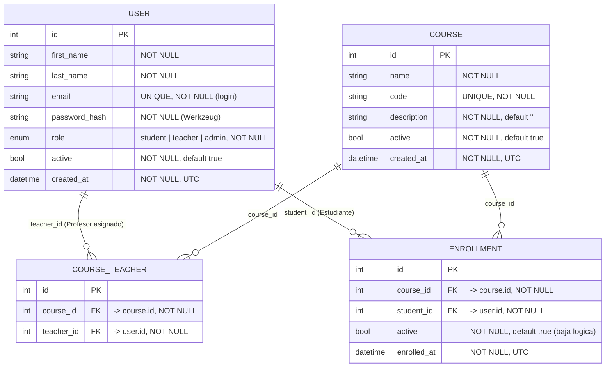

# Diagrama entidad-relación — Base de datos

Esquema de la base SQLite del Campus Virtual, tal como queda en la versión **head `0004`** de las migraciones Alembic (`backend/migrations/versions/`). Fuente de verdad: los modelos SQLAlchemy en `backend/models/`.

## Diagrama



Si el visor no renderiza Mermaid, la relación se lee así:

- `user` 1—N `course_teacher` (por `teacher_id`): un Profesor puede estar asignado a varios cursos.
- `course` 1—N `course_teacher` (por `course_id`): un curso puede tener varios Profesores.
- `user` 1—N `enrollment` (por `student_id`): un Estudiante puede estar inscripto en varios cursos.
- `course` 1—N `enrollment` (por `course_id`): un curso puede tener varias inscripciones.

## Tablas y columnas

### `user`

| Columna | Tipo | Restricción | Nota |
|---------|------|-------------|------|
| `id` | Integer | PK | |
| `first_name` | String(120) | NOT NULL | |
| `last_name` | String(120) | NOT NULL | |
| `email` | String(255) | UNIQUE, NOT NULL | identificador único de la cuenta (se normaliza a minúsculas) |
| `password_hash` | String(255) | NOT NULL | hash Werkzeug; nunca se serializa en las respuestas |
| `role` | Enum | NOT NULL, default `student` | uno de `student` \| `teacher` \| `admin` (roles mutuamente excluyentes) |
| `active` | Boolean | NOT NULL, default `true` | baja lógica; un usuario inactivo no puede autenticarse |
| `created_at` | DateTime(tz) | NOT NULL | UTC |

### `course`

| Columna | Tipo | Restricción | Nota |
|---------|------|-------------|------|
| `id` | Integer | PK | |
| `name` | String(200) | NOT NULL | |
| `code` | String(50) | UNIQUE, NOT NULL | la unicidad case-insensitive se valida en `services/` |
| `description` | String(1000) | NOT NULL, default `""` | |
| `active` | Boolean | NOT NULL, default `true` | baja lógica; un curso inactivo no admite inscribir ni modificar inscripciones |
| `created_at` | DateTime(tz) | NOT NULL | UTC |

### `course_teacher`

| Columna | Tipo | Restricción | Nota |
|---------|------|-------------|------|
| `id` | Integer | PK | |
| `course_id` | Integer | FK → `course.id`, NOT NULL | |
| `teacher_id` | Integer | FK → `user.id`, NOT NULL | debe apuntar a un usuario `role = teacher` (lo exige el servicio) |

Restricción de tabla: `UNIQUE(course_id, teacher_id)` (`uq_course_teacher`).

### `enrollment`

| Columna | Tipo | Restricción | Nota |
|---------|------|-------------|------|
| `id` | Integer | PK | |
| `course_id` | Integer | FK → `course.id`, NOT NULL | |
| `student_id` | Integer | FK → `user.id`, NOT NULL | debe apuntar a un usuario `role = student` (lo exige el servicio) |
| `active` | Boolean | NOT NULL, default `true` | baja lógica reversible (PATCH); el borrado físico es DELETE |
| `enrolled_at` | DateTime(tz) | NOT NULL | UTC |

Restricción de tabla: `UNIQUE(course_id, student_id)` (`uq_enrollment`).

## Invariantes de negocio al cargar datos

- **Rol ↔ relación:** `course_teacher.teacher_id` debe ser un `user` con `role='teacher'`; `enrollment.student_id` debe ser un `user` con `role='student'`. La base **no** lo valida: lo aplican los servicios.
- **Un rol por usuario:** cada `user` tiene exactamente un `role`.
- **Sin duplicados:** un Profesor no se repite en un curso y un Estudiante no se repite en un curso (restricciones UNIQUE).
- **Baja lógica vs física:** `active=false` en `user`, `course` y `enrollment` es baja lógica (los inactivos no se tratan como activos). El borrado de una inscripción (DELETE) es físico.
- **Claves foráneas:** las FK no declaran `ON DELETE`; SQLite tiene el enforcement de FK **desactivado por defecto**, así que borrar un `user`/`course` referenciado no falla pero deja huérfanos. Cargar y borrar a través de los endpoints (o de los seeds), no a mano.
- **Contraseñas:** usar `werkzeug.security.generate_password_hash`; nunca texto plano.

## Cómo poblar la base

1. **Esquema + Administrador + cursos demo** (idempotente):

   ```bash
   # Windows
   $env:CAMPUS_ADMIN_EMAIL="admin@example.com"; $env:CAMPUS_ADMIN_PASSWORD="adminpass123"
   .\.venv\Scripts\python.exe scripts\seed_admin.py
   # Linux/macOS
   CAMPUS_ADMIN_EMAIL=admin@example.com CAMPUS_ADMIN_PASSWORD=adminpass123 .venv/bin/python scripts/seed_admin.py
   ```

2. **Datos de prueba ampliados** (Profesores, Estudiantes, asignaciones e inscripciones; también idempotente):

   ```bash
   # Windows
   .\.venv\Scripts\python.exe scripts\seed_demo.py
   # Linux/macOS
   .venv/bin/python scripts/seed_demo.py
   ```

   Requiere que el Administrador y los cursos demo ya existan (`seed_admin.py`). Credenciales de demo por defecto en `scripts/seed_demo.py`; se pueden sobreescribir con `CAMPUS_DEMO_TEACHER_PASSWORD` / `CAMPUS_DEMO_STUDENT_PASSWORD`.
